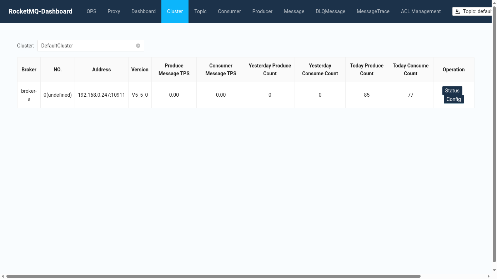
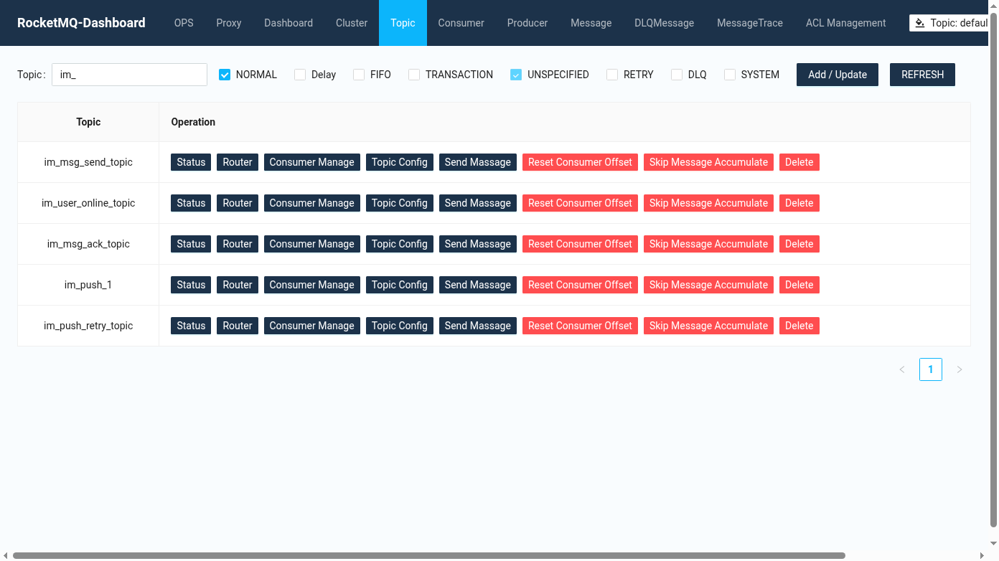

# RocketMQ 安装（Docker Compose）

本文用 Docker Compose 在一台机器上部署 RocketMQ 5.5.0，包含 4 个容器：

- `rocketmq-namesrv`：NameServer，客户端通过它发现 Broker，端口 9876。
- `rocketmq-broker`：存储和投递消息，端口 10911（客户端）、10909（VIP 通道）、10912（主从同步）。
- `rocketmq-proxy`：5.x 的 gRPC 接入层，供 gRPC 客户端使用；tio-boot 使用的 remoting 客户端直连 NameServer 和 Broker，不需要经过它。
- `rocketmq-dashboard`：Web 控制台，用来查看集群、Topic、消费组和按 Key 查消息。

部署完成后，[tio-boot 整合 RocketMQ](./05.md) 中的示例可以直接连上。

## 目录结构

```text
rocketmq/
├── .env
├── docker-compose.yml
├── broker/
│   ├── conf/
│   │   ├── broker.conf
│   │   └── plain_acl.yml
│   ├── logs/
│   └── store/
├── namesrv/
│   ├── logs/
│   └── store/
├── proxy/
│   └── conf/
│       └── rmq-proxy.json
└── timerwheel/
```

```bash
mkdir -p rocketmq && cd rocketmq
mkdir -p broker/conf broker/logs broker/store namesrv/logs namesrv/store proxy/conf timerwheel
# 容器内以 rocketmq 用户运行，需要能写入挂载目录
chmod -R 777 broker/logs broker/store namesrv timerwheel
```

## .env

```properties
ROCKETMQ_VERSION=5.5.0
```

## docker-compose.yml

```yaml
services:
  rocketmq-namesrv:
    image: apache/rocketmq:${ROCKETMQ_VERSION:-5.5.0}
    container_name: rocketmq-namesrv
    restart: always
    ports:
      - 9876:9876
    command: sh mqnamesrv
    volumes:
      - ./namesrv/logs:/home/rocketmq/logs
      - ./namesrv/store:/home/rocketmq/store

  rocketmq-broker:
    image: apache/rocketmq:${ROCKETMQ_VERSION:-5.5.0}
    container_name: rocketmq-broker
    restart: always
    ports:
      - 10909:10909
      - 10911:10911
      - 10912:10912
    environment:
      - NAMESRV_ADDR=rocketmq-namesrv:9876
    volumes:
      - ./broker/logs:/home/rocketmq/logs
      - ./broker/store:/home/rocketmq/store
      - ./timerwheel:/home/rocketmq/timerwheel
      - ./broker/conf/broker.conf:/home/rocketmq/rocketmq-5.5.0/conf/broker.conf
      - ./broker/conf/plain_acl.yml:/home/rocketmq/rocketmq-5.5.0/conf/plain_acl.yml
    depends_on:
      - rocketmq-namesrv
    command: sh mqbroker -c /home/rocketmq/rocketmq-5.5.0/conf/broker.conf

  rocketmq-proxy:
    image: apache/rocketmq:${ROCKETMQ_VERSION:-5.5.0}
    container_name: rocketmq-proxy
    restart: on-failure
    depends_on:
      - rocketmq-broker
      - rocketmq-namesrv
    ports:
      - 8082:8080
      - 8081:8081
    environment:
      - NAMESRV_ADDR=rocketmq-namesrv:9876
    command: sh mqproxy

  rocketmq-dashboard:
    image: apacherocketmq/rocketmq-dashboard:latest
    container_name: rocketmq-dashboard
    restart: always
    depends_on:
      - rocketmq-namesrv
    environment:
      - JAVA_OPTS=-Drocketmq.namesrv.addr=rocketmq-namesrv:9876
    ports:
      - "1024:8082"
```

## broker.conf

`brokerIP1` 是 Broker 注册到 NameServer 的地址，客户端拿到路由后会直接连这个地址。容器内的默认地址是 Docker 内网 IP，宿主机之外的应用连不上，所以这里要填**宿主机的局域网 IP**（`hostname -I` 查看）。

```properties
brokerClusterName=DefaultCluster
brokerName=broker-a
brokerId=0
namesrvAddr=rocketmq-namesrv:9876

# 宿主机 IP，改成自己的
brokerIP1=192.168.1.88
listenPort=10911

proxyMode=NONE
enableControllerMode=false

# 新建 Topic 默认 4 个队列
defaultTopicQueueNums=4
# 开发环境允许自动创建 Topic 和订阅组；生产环境建议关闭，用 mqadmin 预先创建
autoCreateTopicEnable=true
enableAutoCreateSystemTopic=true
enableAutoCreateSubscriptionGroup=true
autoCreateSubscriptionGroup=true

# 是否开启 ACL，开启后客户端要配置 access-key / secret-key
aclEnable=false

deleteWhen=04
fileReservedTime=120
mappedFileSizeCommitLog=1073741824
mappedFileSizeConsumeQueue=300000
diskMaxUsedSpaceRatio=88

storePathRootDir=/home/rocketmq/store
storePathCommitLog=/home/rocketmq/store/commitlog
storePathConsumeQueue=/home/rocketmq/store/consumequeue
storePathIndex=/home/rocketmq/store/index
storeCheckpoint=/home/rocketmq/store/checkpoint
abortFile=/home/rocketmq/store/abort
maxMessageSize=65536

# 定时消息（任意时长延迟）
timerWheelEnable=true
timerStorePath=/home/rocketmq/timerwheel
timerFlushIntervalMs=1000
timerPrecisionMs=1000

# 延迟级别消息：第 n 级对应下面第 n 个时长
enableScheduleMessage=true
messageDelayLevel=1s 3s 5s 10s 30s 1m 2m 3m 4m 5m 6m 7m 8m 9m 10m 20m 30m 1h 2h
scheduleMessageServiceThreadPoolNums=4

brokerRole=ASYNC_MASTER
flushDiskType=ASYNC_FLUSH
maxDirectMemorySize=1g
```

这里同时开启了两种延迟方式：

- **延迟级别**：发送时指定级别 1～19，按 `messageDelayLevel` 换算成时长。上面的配置中级别 2 是 3 秒，级别 3 是 5 秒。适合"3 秒后检查一次是否已读"这类固定档位的重试。
- **定时消息**：5.x 的时间轮，发送时直接指定任意秒数、毫秒数或投递时间点，不受级别限制。

## plain_acl.yml

`aclEnable=false` 时不生效。需要账号鉴权时把 `aclEnable` 改成 `true`，客户端配置对应的 accessKey 和 secretKey。

```yaml
globalWhiteRemoteAddresses:

accounts:
  - accessKey: rocketmq-admin
    secretKey: change-me-admin
    whiteRemoteAddress:
    admin: true

  - accessKey: im-app
    secretKey: change-me-app
    whiteRemoteAddress:
    admin: false
    defaultTopicPerm: PUB|SUB
    defaultGroupPerm: PUB|SUB
```

## rmq-proxy.json

```json
{
  "rocketMQClusterName": "DefaultCluster"
}
```

## 启动与验证

```bash
docker compose up -d
docker ps --format '{{.Names}} {{.Status}}' | grep rocketmq
```

Broker 注册成功后，`clusterList` 能看到 `broker-a`，地址是 `brokerIP1` 配置的宿主机 IP：

```bash
docker exec rocketmq-broker sh mqadmin clusterList -n rocketmq-namesrv:9876
```

```text
#Cluster Name     #Broker Name   #BID  #Addr                 #Version   ...
DefaultCluster    broker-a       0     192.168.0.247:10911   V5_5_0     ...
```

### 预先创建 Topic

生产环境关闭 `autoCreateTopicEnable` 后，Topic 要先创建。`-r` / `-w` 是读写队列数：

```bash
docker exec rocketmq-broker sh mqadmin updateTopic -n rocketmq-namesrv:9876 \
  -c DefaultCluster -t im_msg_send_topic -r 4 -w 4
```

```text
create topic to 192.168.0.247:10911 success.
```

### 控制台

浏览器打开 `http://<宿主机IP>:1024`。Cluster 页面显示 Broker 地址、版本以及当天的生产和消费数量：



用 mqadmin 或自动创建的 Topic 类型是 UNSPECIFIED，在 Topic 页面勾选 UNSPECIFIED 才会显示：



## 常见问题

**客户端报 `connect to <172.x.x.x:10911> failed`**：`brokerIP1` 没配置或配置成了容器 IP，改成宿主机 IP 后重启 Broker。

**Broker 启动后立即退出**：多为挂载目录没有写权限，检查 `broker/logs`、`broker/store`、`timerwheel` 的权限。

**延迟消息没有按预期时间到达**：确认 `messageDelayLevel` 中的级别顺序；客户端指定的是级别序号，不是秒数。
