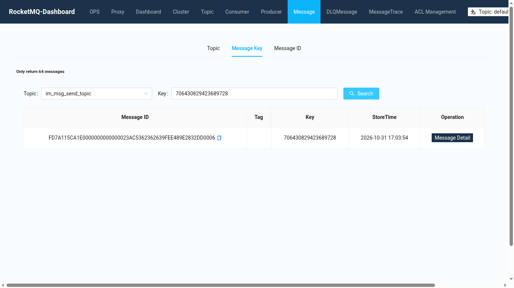
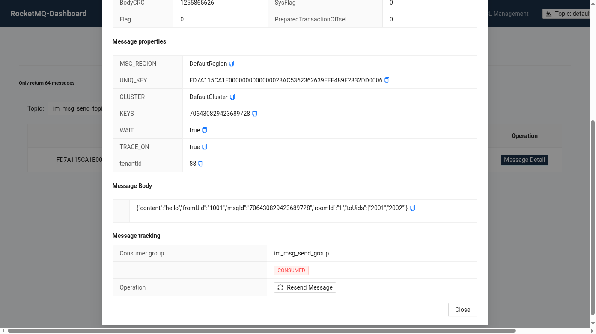

# RocketMQ 即时通讯实战

本文用一个可运行的工程，把 [tio-boot 整合 RocketMQ](./05.md) 的各项能力串成即时通讯（IM）的消息链路。即时通讯后端通常分成"业务服务"和"WebSocket 连接节点"两部分：业务服务负责落库和计算推送对象，连接节点负责把消息写到用户的长连接上。两者之间用 RocketMQ 解耦以后，业务服务可以水平扩容，连接节点也可以随在线人数增减，互不影响。

本文实现的链路：

1. 发送消息：HTTP 接口生成消息 ID，发到 `im_msg_send_topic`（带 Key，方便按消息 ID 查询）。
2. 扇出：`MsgSendListener` 集群消费，计算接收者所在节点，把推送发到该节点专属的 `im_push_{节点ID}`。
3. 定向推送：每个连接节点只订阅自己的 `im_push_${app.node-id}`，收到后写到本地连接。
4. ACK 与重推：推送同时登记"在途"，并发送一条延迟消息；3 秒后检查，仍未 ACK 的用户再推一次，最多 3 次。
5. 上线广播：上线事件用广播消费，每个节点都能更新"用户在哪个节点"的路由表。
6. 租户透传：发送钩子和消费钩子把租户 ID 放在消息属性中，跨多跳自动传递。
7. 可靠发送：消息和本地消息表在同一个事务内写入，提交后发送；发送失败由定时任务重试。

所有代码都在 tio-boot 中实际运行过，结果见文末"运行验证"。RocketMQ 服务端安装见 [RocketMQ 安装（Docker Compose）](./04.md)。

## 依赖与配置

```xml
  <dependency>
    <groupId>ch.qos.logback</groupId>
    <artifactId>logback-classic</artifactId>
    <version>1.3.3</version>
  </dependency>
  <dependency>
    <groupId>nexus.io</groupId>
    <artifactId>tio-boot</artifactId>
    <version>${tio-boot.version}</version>
  </dependency>
  <dependency>
    <groupId>nexus.io</groupId>
    <artifactId>tio-boot-admin-base</artifactId>
    <version>${tio-boot-admin.version}</version>
  </dependency>
  <dependency>
    <groupId>nexus.io</groupId>
    <artifactId>jfinal-aop</artifactId>
    <version>${jfinal-aop.version}</version>
  </dependency>
  <dependency>
    <groupId>com.alibaba.fastjson2</groupId>
    <artifactId>fastjson2</artifactId>
    <version>2.0.52</version>
  </dependency>
  <dependency>
    <groupId>org.apache.rocketmq</groupId>
    <artifactId>rocketmq-client</artifactId>
    <version>5.5.0</version>
  </dependency>
  <dependency>
    <groupId>nexus.io</groupId>
    <artifactId>java-db</artifactId>
    <version>${java-db.version}</version>
  </dependency>
  <dependency>
    <groupId>com.zaxxer</groupId>
    <artifactId>HikariCP</artifactId>
    <version>4.0.3</version>
  </dependency>
  <dependency>
    <groupId>org.postgresql</groupId>
    <artifactId>postgresql</artifactId>
    <version>42.5.0</version>
  </dependency>
```

`app.properties`：

```properties
server.port=8088
app.node-id=1

rocketmq.name-server=127.0.0.1:9876
rocketmq.producer.group=im_producer_group
rocketmq.producer.send-message-timeout=3000
rocketmq.producer.retry-times-when-send-failed=2
rocketmq.producer.compress-message-body-threshold=4096
rocketmq.producer.max-message-size=4194304

jdbc.url=jdbc:postgresql://127.0.0.1:5433/im_demo
jdbc.user=postgres
jdbc.pswd=your-password
```

多节点部署时，每个连接节点配置不同的 `app.node-id`。

工程结构：

```text
com.example.im
├── ImApp.java
├── config      RocketMqConfiguration、HttpRouteConfiguration、GlobalExceptionHandler、DbConfiguration、OutboxRetryConfiguration
├── handler     SendMessageHandler、ReliableSendMessageHandler、AckHandler、OnlineHandler、InboxHandler
├── hook        TenantContext、TenantSendMessageHook、TenantConsumeMessageHook
├── listener    MsgSendListener、NodePushListener、RetryPushListener、AckListener、UserOnlineListener
├── model       ImTopics、ChatMessage、NodePush、AckMessage、OnlineEvent
├── service     ChatService、PushService、OnlineService、OutboxService、ReliableChatService
└── utils       ParameterValidationUtils
```

## 启动类

```java
package com.example.im;

import nexus.io.annotation.AComponentScan;
import nexus.io.tio.boot.TioApplication;

@AComponentScan
public class ImApp {
  public static void main(String[] args) {
    TioApplication.run(ImApp.class, args);
  }
}
```

## Topic 与消息模型

Topic 名称集中定义。推送 Topic 只定义前缀，节点 ID 在注解中用占位符补全：

```java
package com.example.im.model;

public interface ImTopics {
  String MSG_SEND = "im_msg_send_topic";
  String MSG_SEND_GROUP = "im_msg_send_group";

  String MSG_ACK = "im_msg_ack_topic";
  String MSG_ACK_GROUP = "im_msg_ack_group";

  /** One topic per WebSocket node: im_push_1, im_push_2 ... */
  String PUSH_PREFIX = "im_push_";
  String PUSH_GROUP_PREFIX = "im_push_group_";

  String PUSH_RETRY = "im_push_retry_topic";
  String PUSH_RETRY_GROUP = "im_push_retry_group";

  String USER_ONLINE = "im_user_online_topic";
  String USER_ONLINE_GROUP = "im_user_online_group";
}
```

`ChatMessage` 是客户端发来的聊天消息：

```java
package com.example.im.model;

import java.util.List;

public class ChatMessage {
  private Long msgId;
  private Long roomId;
  private Long fromUid;
  private List<Long> toUids;
  private String content;

  public Long getMsgId() {
    return msgId;
  }

  public void setMsgId(Long msgId) {
    this.msgId = msgId;
  }

  public Long getRoomId() {
    return roomId;
  }

  public void setRoomId(Long roomId) {
    this.roomId = roomId;
  }

  public Long getFromUid() {
    return fromUid;
  }

  public void setFromUid(Long fromUid) {
    this.fromUid = fromUid;
  }

  public List<Long> getToUids() {
    return toUids;
  }

  public void setToUids(List<Long> toUids) {
    this.toUids = toUids;
  }

  public String getContent() {
    return content;
  }

  public void setContent(String content) {
    this.content = content;
  }
}
```

`NodePush` 是发给某个节点的推送，`attempt` 记录第几次推送：

```java
package com.example.im.model;

import java.util.List;

public class NodePush {
  private Long msgId;
  private List<Long> uids;
  private String content;
  private int attempt;

  public NodePush() {
  }

  public NodePush(Long msgId, List<Long> uids, String content, int attempt) {
    this.msgId = msgId;
    this.uids = uids;
    this.content = content;
    this.attempt = attempt;
  }

  public Long getMsgId() {
    return msgId;
  }

  public void setMsgId(Long msgId) {
    this.msgId = msgId;
  }

  public List<Long> getUids() {
    return uids;
  }

  public void setUids(List<Long> uids) {
    this.uids = uids;
  }

  public String getContent() {
    return content;
  }

  public void setContent(String content) {
    this.content = content;
  }

  public int getAttempt() {
    return attempt;
  }

  public void setAttempt(int attempt) {
    this.attempt = attempt;
  }
}
```

`AckMessage` 是客户端回执：

```java
package com.example.im.model;

public class AckMessage {
  private Long msgId;
  private Long uid;

  public Long getMsgId() {
    return msgId;
  }

  public void setMsgId(Long msgId) {
    this.msgId = msgId;
  }

  public Long getUid() {
    return uid;
  }

  public void setUid(Long uid) {
    this.uid = uid;
  }
}
```

`OnlineEvent` 是上线事件：

```java
package com.example.im.model;

public class OnlineEvent {
  private Long uid;
  private String nodeId;

  public OnlineEvent() {
  }

  public OnlineEvent(Long uid, String nodeId) {
    this.uid = uid;
    this.nodeId = nodeId;
  }

  public Long getUid() {
    return uid;
  }

  public void setUid(Long uid) {
    this.uid = uid;
  }

  public String getNodeId() {
    return nodeId;
  }

  public void setNodeId(String nodeId) {
    this.nodeId = nodeId;
  }
}
```

## 租户上下文与钩子

接口入口把请求头里的租户 ID 放进 `TenantContext`，发送钩子写入消息属性，消费钩子在监听器执行前还原。监听器中再发出的消息会被发送钩子继续带上，所以"接口 → 扇出 → 节点推送"三跳都能拿到同一个租户。

```java
package com.example.im.hook;

public class TenantContext {
  private static final ThreadLocal<String> TENANT_ID = new ThreadLocal<>();

  public static void set(String tenantId) {
    TENANT_ID.set(tenantId);
  }

  public static String get() {
    return TENANT_ID.get();
  }

  public static void clear() {
    TENANT_ID.remove();
  }
}
```

```java
package com.example.im.hook;

import org.apache.rocketmq.client.hook.SendMessageContext;
import org.apache.rocketmq.client.hook.SendMessageHook;

/** Copies the tenant id of the current thread into every outgoing message. */
public class TenantSendMessageHook implements SendMessageHook {

  public static final String HEADER_TENANT_ID = "tenantId";

  @Override
  public String hookName() {
    return "TenantSendMessageHook";
  }

  @Override
  public void sendMessageBefore(SendMessageContext context) {
    String tenantId = TenantContext.get();
    if (tenantId != null) {
      context.getMessage().putUserProperty(HEADER_TENANT_ID, tenantId);
    }
  }

  @Override
  public void sendMessageAfter(SendMessageContext context) {
  }
}
```

```java
package com.example.im.hook;

import org.apache.rocketmq.client.hook.ConsumeMessageContext;
import org.apache.rocketmq.client.hook.ConsumeMessageHook;
import org.apache.rocketmq.common.message.MessageExt;

/** Restores the tenant id before the listener runs and clears it afterwards. */
public class TenantConsumeMessageHook implements ConsumeMessageHook {

  @Override
  public String hookName() {
    return "TenantConsumeMessageHook";
  }

  @Override
  public void consumeMessageBefore(ConsumeMessageContext context) {
    MessageExt message = context.getMsgList().get(0);
    String tenantId = message.getUserProperty(TenantSendMessageHook.HEADER_TENANT_ID);
    if (tenantId != null) {
      TenantContext.set(tenantId);
    }
  }

  @Override
  public void consumeMessageAfter(ConsumeMessageContext context) {
    TenantContext.clear();
  }
}
```

## 注册监听器

`TioAdminRocketMqConfig` 读取 `rocketmq.*` 配置，注册钩子和监听器并启动；没有配置 `rocketmq.name-server` 时直接跳过。

```java
package com.example.im.config;

import com.example.im.hook.TenantConsumeMessageHook;
import com.example.im.hook.TenantSendMessageHook;
import com.example.im.listener.AckListener;
import com.example.im.listener.MsgSendListener;
import com.example.im.listener.NodePushListener;
import com.example.im.listener.RetryPushListener;
import com.example.im.listener.UserOnlineListener;

import nexus.io.annotation.AConfiguration;
import nexus.io.annotation.Initialization;
import nexus.io.tio.boot.admin.config.TioAdminRocketMqConfig;

@AConfiguration
public class RocketMqConfiguration {

  @Initialization
  public void config() {
    new TioAdminRocketMqConfig()
        .addSendMessageHook(new TenantSendMessageHook())
        .addConsumeMessageHook(new TenantConsumeMessageHook())
        .addListener(new MsgSendListener())
        .addListener(new NodePushListener())
        .addListener(new RetryPushListener())
        .addListener(new AckListener())
        .addListener(new UserOnlineListener())
        .config();
  }
}
```

## 发送消息

`ChatService` 生成雪花 ID，把消息 ID 设为 Key 发送。接口很快返回，后续扇出与推送都在消费端异步完成：

```java
package com.example.im.service;

import com.example.im.model.ChatMessage;
import com.example.im.model.ImTopics;

import nexus.io.tio.boot.admin.rocketmq.RocketMq;
import nexus.io.tio.boot.admin.rocketmq.RocketMqMessage;
import nexus.io.tio.utils.snowflake.SnowflakeIdUtils;

public class ChatService {

  /** Saves nothing in this demo; publishes the message and returns its id. */
  public long send(ChatMessage message) {
    long msgId = SnowflakeIdUtils.id();
    message.setMsgId(msgId);
    RocketMq.getTemplate().send(ImTopics.MSG_SEND, RocketMqMessage.of(message).keys(msgId));
    return msgId;
  }
}
```

## 扇出到节点

`MsgSendListener` 集群消费，多个业务服务实例分摊处理。它把消息转成 `NodePush`，发到接收者所在节点的 Topic，并安排重推检查。示例只有一个节点；多节点时先通过上线路由表查出每个用户所在的节点，再按节点分组发送。

```java
package com.example.im.listener;

import com.example.im.model.ChatMessage;
import com.example.im.model.ImTopics;
import com.example.im.model.NodePush;
import com.example.im.service.PushService;

import nexus.io.jfinal.aop.Aop;
import nexus.io.tio.boot.admin.rocketmq.RocketMqListener;
import nexus.io.tio.boot.admin.rocketmq.RocketMqMessageListener;

@RocketMqMessageListener(topic = ImTopics.MSG_SEND, consumerGroup = ImTopics.MSG_SEND_GROUP)
public class MsgSendListener implements RocketMqListener<ChatMessage> {

  @Override
  public void onMessage(ChatMessage message) {
    PushService pushService = Aop.get(PushService.class);
    NodePush push = new NodePush(message.getMsgId(), message.getToUids(), message.getContent(), 1);
    // This demo runs one node; a cluster looks up the node of each user and groups by node id.
    pushService.pushToNode(pushService.currentNodeId(), push);
    pushService.trackAndScheduleRetry(push);
  }
}
```

## 节点定向推送

每个节点只订阅自己的 Topic。`${app.node-id}` 在启动时从配置中解析，节点 1 订阅 `im_push_1`，节点 2 订阅 `im_push_2`，推送不会发到无关的节点：

```java
package com.example.im.listener;

import com.example.im.model.ImTopics;
import com.example.im.model.NodePush;
import com.example.im.service.PushService;

import nexus.io.jfinal.aop.Aop;
import nexus.io.tio.boot.admin.rocketmq.RocketMqListener;
import nexus.io.tio.boot.admin.rocketmq.RocketMqMessageListener;

/** Every node only subscribes to its own push topic, e.g. im_push_1. */
@RocketMqMessageListener(topic = ImTopics.PUSH_PREFIX + "${app.node-id}",
    consumerGroup = ImTopics.PUSH_GROUP_PREFIX + "${app.node-id}", maxReconsumeTimes = 3)
public class NodePushListener implements RocketMqListener<NodePush> {

  @Override
  public void onMessage(NodePush push) {
    Aop.get(PushService.class).deliver(push);
  }
}
```

## 推送、ACK 与延迟重推

`PushService` 负责三件事：

- `pushToNode`：发到节点 Topic。
- `trackAndScheduleRetry`：为每个接收者登记"在途"，再用延迟级别 2（Broker 配置 `messageDelayLevel=1s 3s 5s ...` 时为 3 秒）发一条检查消息。
- `retryIfNotAcked`：检查时间到，仍在途的用户再推一次，并重新安排检查；达到 3 次后放弃，等客户端上线后拉取离线消息。

示例的在途表和收件箱放在内存中。多实例部署时在途表要放到 Redis 这类共享存储中，各节点看到同一份状态。

```java
package com.example.im.service;

import java.util.ArrayList;
import java.util.List;
import java.util.Map;
import java.util.concurrent.ConcurrentHashMap;
import java.util.concurrent.CopyOnWriteArrayList;

import org.slf4j.Logger;
import org.slf4j.LoggerFactory;

import com.example.im.hook.TenantContext;
import com.example.im.model.ImTopics;
import com.example.im.model.NodePush;

import nexus.io.tio.boot.admin.rocketmq.RocketMq;
import nexus.io.tio.utils.environment.EnvUtils;

public class PushService {
  private static final Logger log = LoggerFactory.getLogger(PushService.class);

  /** Delay level 2 = 3s with messageDelayLevel=1s 3s 5s ... */
  private static final int RETRY_DELAY_LEVEL = 2;
  private static final int MAX_ATTEMPTS = 3;

  // Demo storage. Use Redis sets in production so every node sees the same state.
  private static final Map<String, Boolean> pending = new ConcurrentHashMap<>();
  private static final Map<Long, List<String>> inbox = new ConcurrentHashMap<>();

  public String currentNodeId() {
    return EnvUtils.get("app.node-id", "1");
  }

  /** Sends a push to the topic of the node that holds the users' connections. */
  public void pushToNode(String nodeId, NodePush push) {
    RocketMq.getTemplate().send(ImTopics.PUSH_PREFIX + nodeId, push);
  }

  /** Marks the message as in flight and schedules a check after the delay. */
  public void trackAndScheduleRetry(NodePush push) {
    for (Long uid : push.getUids()) {
      pending.put(key(uid, push.getMsgId()), Boolean.TRUE);
    }
    RocketMq.getTemplate().syncSend(ImTopics.PUSH_RETRY, push, 3000, RETRY_DELAY_LEVEL);
  }

  /** Called by the retry listener: pushes again to users that have not acked yet. */
  public void retryIfNotAcked(NodePush push) {
    List<Long> notAcked = new ArrayList<>();
    for (Long uid : push.getUids()) {
      if (pending.containsKey(key(uid, push.getMsgId()))) {
        notAcked.add(uid);
      }
    }
    if (notAcked.isEmpty()) {
      log.info("msgId={} acked by all users, no retry", push.getMsgId());
      return;
    }
    if (push.getAttempt() >= MAX_ATTEMPTS) {
      log.warn("msgId={} still not acked by {} after {} attempts, give up", push.getMsgId(), notAcked,
          push.getAttempt());
      return;
    }
    NodePush retry = new NodePush(push.getMsgId(), notAcked, push.getContent(), push.getAttempt() + 1);
    log.info("msgId={} not acked by {}, push again, attempt={}", push.getMsgId(), notAcked, retry.getAttempt());
    pushToNode(currentNodeId(), retry);
    trackAndScheduleRetry(retry);
  }

  /** Delivers to local connections. A real server writes to the WebSocket channel here. */
  public void deliver(NodePush push) {
    for (Long uid : push.getUids()) {
      inbox.computeIfAbsent(uid, k -> new CopyOnWriteArrayList<>())
          .add(push.getMsgId() + ":" + push.getContent() + "#" + push.getAttempt());
    }
    log.info("node={} delivered msgId={} to {}, attempt={}, tenant={}", currentNodeId(), push.getMsgId(),
        push.getUids(), push.getAttempt(), TenantContext.get());
  }

  public void ack(Long uid, Long msgId) {
    pending.remove(key(uid, msgId));
  }

  public List<String> inbox(Long uid) {
    List<String> list = inbox.get(uid);
    if (list == null) {
      return new ArrayList<>();
    }
    return new ArrayList<>(list);
  }

  private static String key(Long uid, Long msgId) {
    return uid + ":" + msgId;
  }
}
```

延迟检查的消费者：

```java
package com.example.im.listener;

import com.example.im.model.ImTopics;
import com.example.im.model.NodePush;
import com.example.im.service.PushService;

import nexus.io.jfinal.aop.Aop;
import nexus.io.tio.boot.admin.rocketmq.RocketMqListener;
import nexus.io.tio.boot.admin.rocketmq.RocketMqMessageListener;

@RocketMqMessageListener(topic = ImTopics.PUSH_RETRY, consumerGroup = ImTopics.PUSH_RETRY_GROUP, maxReconsumeTimes = 3)
public class RetryPushListener implements RocketMqListener<NodePush> {

  @Override
  public void onMessage(NodePush push) {
    Aop.get(PushService.class).retryIfNotAcked(push);
  }
}
```

客户端收到消息后调用 ACK 接口，ACK 经 MQ 回到业务服务，删除在途记录：

```java
package com.example.im.listener;

import com.example.im.model.AckMessage;
import com.example.im.model.ImTopics;
import com.example.im.service.PushService;

import nexus.io.jfinal.aop.Aop;
import nexus.io.tio.boot.admin.rocketmq.RocketMqListener;
import nexus.io.tio.boot.admin.rocketmq.RocketMqMessageListener;

@RocketMqMessageListener(topic = ImTopics.MSG_ACK, consumerGroup = ImTopics.MSG_ACK_GROUP)
public class AckListener implements RocketMqListener<AckMessage> {

  @Override
  public void onMessage(AckMessage ack) {
    Aop.get(PushService.class).ack(ack.getUid(), ack.getMsgId());
  }
}
```

## 上线广播

上线事件用广播消费，每个节点都收到，各自维护"用户 → 节点"的路由表。消费组相同、实例不同的节点都会收到同一条事件：

```java
package com.example.im.service;

import java.util.Map;
import java.util.concurrent.ConcurrentHashMap;

import com.example.im.model.ImTopics;
import com.example.im.model.OnlineEvent;

import nexus.io.jfinal.aop.Aop;
import nexus.io.tio.boot.admin.rocketmq.RocketMq;

public class OnlineService {

  // uid -> node id, filled on every node by the broadcasting listener.
  private static final Map<Long, String> userNodes = new ConcurrentHashMap<>();

  public void online(Long uid) {
    String nodeId = Aop.get(PushService.class).currentNodeId();
    RocketMq.getTemplate().send(ImTopics.USER_ONLINE, new OnlineEvent(uid, nodeId));
  }

  public void onOnline(OnlineEvent event) {
    userNodes.put(event.getUid(), event.getNodeId());
  }

  public String nodeOf(Long uid) {
    return userNodes.get(uid);
  }
}
```

```java
package com.example.im.listener;

import org.slf4j.Logger;
import org.slf4j.LoggerFactory;

import com.example.im.model.ImTopics;
import com.example.im.model.OnlineEvent;
import com.example.im.service.OnlineService;

import nexus.io.jfinal.aop.Aop;
import nexus.io.tio.boot.admin.rocketmq.RocketMqListener;
import nexus.io.tio.boot.admin.rocketmq.RocketMqMessageListener;
import org.apache.rocketmq.remoting.protocol.heartbeat.MessageModel;

/** BROADCASTING: every node of the group receives every online event. */
@RocketMqMessageListener(topic = ImTopics.USER_ONLINE, consumerGroup = ImTopics.USER_ONLINE_GROUP,
    messageModel = MessageModel.BROADCASTING)
public class UserOnlineListener implements RocketMqListener<OnlineEvent> {
  private static final Logger log = LoggerFactory.getLogger(UserOnlineListener.class);

  @Override
  public void onMessage(OnlineEvent event) {
    Aop.get(OnlineService.class).onOnline(event);
    log.info("user {} is online on node {}", event.getUid(), event.getNodeId());
  }
}
```

## HTTP 接口

参数校验封装在工具类中，内部使用 `ParameterValidator`：

```java
package com.example.im.utils;

import nexus.io.tio.http.common.HttpRequest;
import nexus.io.tio.utils.validator.ParameterValidator;

public class ParameterValidationUtils {

  public static String requestBody(HttpRequest request, int maxLength) {
    String body = request.getBodyString();
    ParameterValidator.require(body != null && !body.isEmpty(), "请求体不能为空");
    ParameterValidator.require(body.length() <= maxLength, "请求体过大");
    return body;
  }

  public static void required(Object value, String message) {
    ParameterValidator.require(value != null, message);
  }
}
```

`POST /api/im/send`，从请求头 `x-tenant-id` 取租户：

```java
package com.example.im.handler;

import com.example.im.hook.TenantContext;
import com.example.im.model.ChatMessage;
import com.example.im.service.ChatService;
import com.example.im.utils.ParameterValidationUtils;

import nexus.io.jfinal.aop.Aop;
import nexus.io.model.body.RespBodyVo;
import nexus.io.tio.boot.http.TioRequestContext;
import nexus.io.tio.http.common.HttpRequest;
import nexus.io.tio.http.common.HttpResponse;
import nexus.io.tio.utils.json.JsonUtils;

/** POST /api/im/send */
public class SendMessageHandler {
  public HttpResponse handle(HttpRequest request) {
    String bodyString = ParameterValidationUtils.requestBody(request, 16384);
    ChatMessage input = JsonUtils.parse(bodyString, ChatMessage.class);
    ParameterValidationUtils.required(input.getToUids(), "toUids 不能为空");
    ParameterValidationUtils.required(input.getContent(), "content 不能为空");

    TenantContext.set(request.getHeader("x-tenant-id"));
    try {
      ChatService chatService = Aop.get(ChatService.class);
      long msgId = chatService.send(input);
      return TioRequestContext.getResponse().respond(RespBodyVo.ok(String.valueOf(msgId)));
    } finally {
      TenantContext.clear();
    }
  }
}
```

`POST /api/im/ack`：

```java
package com.example.im.handler;

import com.example.im.model.AckMessage;
import com.example.im.model.ImTopics;
import com.example.im.utils.ParameterValidationUtils;

import nexus.io.model.body.RespBodyVo;
import nexus.io.tio.boot.http.TioRequestContext;
import nexus.io.tio.boot.admin.rocketmq.RocketMq;
import nexus.io.tio.http.common.HttpRequest;
import nexus.io.tio.http.common.HttpResponse;
import nexus.io.tio.utils.json.JsonUtils;

/** POST /api/im/ack — the client confirms that a message arrived. */
public class AckHandler {
  public HttpResponse handle(HttpRequest request) {
    String bodyString = ParameterValidationUtils.requestBody(request, 1024);
    AckMessage ack = JsonUtils.parse(bodyString, AckMessage.class);
    ParameterValidationUtils.required(ack.getMsgId(), "msgId 不能为空");
    ParameterValidationUtils.required(ack.getUid(), "uid 不能为空");
    RocketMq.send(ImTopics.MSG_ACK, ack);
    return TioRequestContext.getResponse().respond(RespBodyVo.ok());
  }
}
```

`POST /api/im/online`：

```java
package com.example.im.handler;

import com.example.im.service.OnlineService;

import nexus.io.jfinal.aop.Aop;
import nexus.io.model.body.RespBodyVo;
import nexus.io.tio.boot.http.TioRequestContext;
import nexus.io.tio.http.common.HttpRequest;
import nexus.io.tio.http.common.HttpResponse;
import nexus.io.tio.utils.validator.ParameterValidator;

/** POST /api/im/online?uid=1 */
public class OnlineHandler {
  public HttpResponse handle(HttpRequest request) {
    long uid = ParameterValidator.id(request.getParam("uid"), "uid");
    Aop.get(OnlineService.class).online(uid);
    return TioRequestContext.getResponse().respond(RespBodyVo.ok());
  }
}
```

`GET /api/im/inbox`，查看某个用户在本节点收到的推送，用于观察效果：

```java
package com.example.im.handler;

import com.example.im.service.OnlineService;
import com.example.im.service.PushService;

import nexus.io.jfinal.aop.Aop;
import nexus.io.model.body.RespBodyVo;
import nexus.io.tio.boot.http.TioRequestContext;
import nexus.io.tio.http.common.HttpRequest;
import nexus.io.tio.http.common.HttpResponse;
import nexus.io.tio.utils.json.JsonUtils;
import nexus.io.tio.utils.validator.ParameterValidator;

/** GET /api/im/inbox?uid=1 — what has been pushed to this user on this node. */
public class InboxHandler {
  public HttpResponse handle(HttpRequest request) {
    long uid = ParameterValidator.id(request.getParam("uid"), "uid");
    String node = Aop.get(OnlineService.class).nodeOf(uid);
    String data = JsonUtils.toJson(Aop.get(PushService.class).inbox(uid));
    return TioRequestContext.getResponse().respond(RespBodyVo.ok("node=" + node + " " + data));
  }
}
```

全局异常处理器把 `ParameterValidationException` 转成 400：

```java
package com.example.im.config;

import nexus.io.model.body.RespBodyVo;
import nexus.io.model.exception.ParameterValidationException;
import nexus.io.tio.boot.exception.TioBootExceptionHandler;
import nexus.io.tio.boot.http.TioRequestContext;
import nexus.io.tio.core.ChannelContext;
import nexus.io.tio.http.common.HttpRequest;
import nexus.io.tio.websocket.common.WebSocketRequest;

public class GlobalExceptionHandler implements TioBootExceptionHandler {

  @Override
  public Object handler(HttpRequest request, Throwable e) {
    if (e instanceof ParameterValidationException) {
      TioRequestContext.getResponse().setStatus(400);
      return RespBodyVo.fail(e.getMessage());
    }
    return null;
  }

  @Override
  public Object wsTextHandler(WebSocketRequest webSocketRequest, String text, ChannelContext channelContext,
      HttpRequest httpRequest, Throwable e) {
    return null;
  }

  @Override
  public Object wsBytesHandler(WebSocketRequest webSocketRequest, byte[] bytes, ChannelContext channelContext,
      HttpRequest httpRequest, Throwable e) {
    return null;
  }
}
```

注册路由：

```java
package com.example.im.config;

import com.example.im.handler.AckHandler;
import com.example.im.handler.InboxHandler;
import com.example.im.handler.OnlineHandler;
import com.example.im.handler.ReliableSendMessageHandler;
import com.example.im.handler.SendMessageHandler;

import nexus.io.annotation.AConfiguration;
import nexus.io.annotation.Initialization;
import nexus.io.tio.boot.server.TioBootServer;
import nexus.io.tio.http.server.router.HttpRequestRouter;

@AConfiguration
public class HttpRouteConfiguration {

  @Initialization
  public void config() {
    TioBootServer.me().setExceptionHandler(new GlobalExceptionHandler());
    HttpRequestRouter r = TioBootServer.me().getRequestRouter();
    r.post("/api/im/send", new SendMessageHandler()::handle);
    r.post("/api/im/send-reliable", new ReliableSendMessageHandler()::handle);
    r.post("/api/im/ack", new AckHandler()::handle);
    r.post("/api/im/online", new OnlineHandler()::handle);
    r.get("/api/im/inbox", new InboxHandler()::handle);
  }
}
```

## 事务提交后发送：本地消息表

"先写库再发 MQ"有两个问题：在事务内发送，事务回滚了消息却已经发出；在事务后发送，发送失败消息就丢了。本地消息表（Outbox）的做法是把待发送的消息和业务数据写在同一个事务里，提交后立即发送，发送成功删除记录，失败的由定时任务重试。只要事务提交成功，消息最终一定会发出。

数据源与表结构：

```java
package com.example.im.config;

import com.zaxxer.hikari.HikariConfig;
import com.zaxxer.hikari.HikariDataSource;

import nexus.io.annotation.AConfiguration;
import nexus.io.annotation.Initialization;
import nexus.io.db.activerecord.ActiveRecordPlugin;
import nexus.io.db.activerecord.Db;
import nexus.io.db.activerecord.dialect.PostgreSqlDialect;
import nexus.io.hook.HookCan;
import nexus.io.tio.utils.environment.EnvUtils;

@AConfiguration
public class DbConfiguration {

  private static final String SCHEMA = """
      CREATE TABLE IF NOT EXISTS im_message (
        id BIGINT PRIMARY KEY,
        room_id BIGINT,
        from_uid BIGINT,
        content TEXT NOT NULL,
        create_time TIMESTAMP NOT NULL DEFAULT now()
      );
      CREATE TABLE IF NOT EXISTS mq_outbox (
        id BIGINT PRIMARY KEY,
        topic VARCHAR(128) NOT NULL,
        msg_keys VARCHAR(128),
        body TEXT NOT NULL,
        retry_count INT NOT NULL DEFAULT 0,
        next_retry_time TIMESTAMP NOT NULL,
        create_time TIMESTAMP NOT NULL DEFAULT now()
      );
      """;

  @Initialization
  public void config() {
    String jdbcUrl = EnvUtils.get("jdbc.url");
    if (jdbcUrl == null) {
      return;
    }
    HikariConfig config = new HikariConfig();
    config.setJdbcUrl(jdbcUrl);
    config.setUsername(EnvUtils.get("jdbc.user"));
    config.setPassword(EnvUtils.get("jdbc.pswd"));
    config.setMaximumPoolSize(EnvUtils.getInt("jdbc.MaximumPoolSize", 4));
    HikariDataSource dataSource = new HikariDataSource(config);
    HookCan.me().addDestroyMethod(dataSource::close);

    ActiveRecordPlugin arp = new ActiveRecordPlugin(dataSource);
    arp.setDialect(new PostgreSqlDialect());
    arp.start();
    HookCan.me().addDestroyMethod(arp::stop);

    Db.update(SCHEMA);
  }
}
```

`OutboxService` 写入、发送和重试本地消息。消息体已经是 JSON 字符串，用 `String` 原样发送，消费端按 `ChatMessage` 解析：

```java
package com.example.im.service;

import java.sql.Timestamp;
import java.util.List;

import org.slf4j.Logger;
import org.slf4j.LoggerFactory;

import nexus.io.db.activerecord.Db;
import nexus.io.db.activerecord.Row;
import nexus.io.tio.boot.admin.rocketmq.RocketMq;
import nexus.io.tio.boot.admin.rocketmq.RocketMqMessage;
import nexus.io.tio.utils.json.JsonUtils;
import nexus.io.tio.utils.snowflake.SnowflakeIdUtils;

/**
 * Transactional outbox: the outbox row is written in the business transaction, the message is
 * sent after commit, and rows that failed to send are retried by a scheduled task.
 */
public class OutboxService {
  private static final Logger log = LoggerFactory.getLogger(OutboxService.class);

  private static final int MAX_RETRY = 10;
  private static final long RETRY_INTERVAL_MILLIS = 60_000L;

  /** Must be called inside Db.tx(...). Returns the outbox id. */
  public long add(String topic, Object keys, Object payload) {
    long id = SnowflakeIdUtils.id();
    Row row = Row.by("id", id)
        .set("topic", topic)
        .set("msg_keys", keys == null ? null : keys.toString())
        .set("body", JsonUtils.toJson(payload))
        .set("next_retry_time", new Timestamp(System.currentTimeMillis() + RETRY_INTERVAL_MILLIS));
    Db.save("mq_outbox", row);
    return id;
  }

  /** Sends one outbox row; deletes it on success, pushes the next retry time on failure. */
  public boolean trySend(long outboxId) {
    Row row = Db.findById("mq_outbox", outboxId);
    if (row == null) {
      return true;
    }
    try {
      RocketMq.getTemplate().send(row.getStr("topic"),
          RocketMqMessage.of(row.getStr("body")).keys(row.getStr("msg_keys")));
      Db.deleteById("mq_outbox", outboxId);
      return true;
    } catch (Exception e) {
      int retryCount = row.getInt("retry_count") + 1;
      long next = System.currentTimeMillis() + RETRY_INTERVAL_MILLIS * retryCount;
      String sql = """
          UPDATE mq_outbox SET retry_count = ?, next_retry_time = ? WHERE id = ?
          """;
      Db.update(sql, retryCount, new Timestamp(next), outboxId);
      log.warn("outbox {} send failed, retry {}", outboxId, retryCount, e);
      return false;
    }
  }

  /** Called periodically: resends rows whose retry time has come. */
  public int retryDue() {
    String sql = """
        SELECT id FROM mq_outbox
        WHERE next_retry_time <= now() AND retry_count < ?
        ORDER BY next_retry_time
        LIMIT 100
        """;
    List<Row> rows = Db.find(sql, MAX_RETRY);
    int sent = 0;
    for (Row row : rows) {
      if (trySend(row.getLong("id"))) {
        sent++;
      }
    }
    return sent;
  }
}
```

业务服务在同一个 `Db.tx` 中写消息表和本地消息表，提交后立即尝试发送：

```java
package com.example.im.service;

import com.example.im.model.ChatMessage;
import com.example.im.model.ImTopics;

import nexus.io.db.activerecord.Db;
import nexus.io.db.activerecord.Row;
import nexus.io.jfinal.aop.Aop;
import nexus.io.tio.utils.snowflake.SnowflakeIdUtils;

public class ReliableChatService {

  /** Stores the message and its outbox row in one transaction, then sends after commit. */
  public long send(ChatMessage message) {
    OutboxService outboxService = Aop.get(OutboxService.class);
    long msgId = SnowflakeIdUtils.id();
    message.setMsgId(msgId);
    long[] outboxId = new long[1];
    Db.tx(() -> {
      Row row = Row.by("id", msgId)
          .set("room_id", message.getRoomId())
          .set("from_uid", message.getFromUid())
          .set("content", message.getContent());
      Db.save("im_message", row);
      outboxId[0] = outboxService.add(ImTopics.MSG_SEND, msgId, message);
      return true;
    });
    // Committed: the message is either sent now or later by the retry task.
    outboxService.trySend(outboxId[0]);
    return msgId;
  }
}
```

定时重试：

```java
package com.example.im.config;

import java.util.concurrent.Executors;
import java.util.concurrent.ScheduledExecutorService;
import java.util.concurrent.TimeUnit;

import org.slf4j.Logger;
import org.slf4j.LoggerFactory;

import com.example.im.service.OutboxService;

import nexus.io.annotation.AConfiguration;
import nexus.io.annotation.Initialization;
import nexus.io.hook.HookCan;
import nexus.io.jfinal.aop.Aop;
import nexus.io.tio.utils.environment.EnvUtils;

@AConfiguration
public class OutboxRetryConfiguration {
  private static final Logger log = LoggerFactory.getLogger(OutboxRetryConfiguration.class);

  @Initialization
  public void config() {
    if (EnvUtils.get("jdbc.url") == null) {
      return;
    }
    ScheduledExecutorService scheduler = Executors.newSingleThreadScheduledExecutor();
    scheduler.scheduleWithFixedDelay(() -> {
      try {
        int sent = Aop.get(OutboxService.class).retryDue();
        if (sent > 0) {
          log.info("outbox resent {} messages", sent);
        }
      } catch (Exception e) {
        log.error("outbox retry failed", e);
      }
    }, 10, 10, TimeUnit.SECONDS);
    HookCan.me().addDestroyMethod(scheduler::shutdown);
  }
}
```

`POST /api/im/send-reliable`：

```java
package com.example.im.handler;

import com.example.im.model.ChatMessage;
import com.example.im.service.ReliableChatService;
import com.example.im.utils.ParameterValidationUtils;

import nexus.io.jfinal.aop.Aop;
import nexus.io.model.body.RespBodyVo;
import nexus.io.tio.boot.http.TioRequestContext;
import nexus.io.tio.http.common.HttpRequest;
import nexus.io.tio.http.common.HttpResponse;
import nexus.io.tio.utils.json.JsonUtils;

/** POST /api/im/send-reliable */
public class ReliableSendMessageHandler {
  public HttpResponse handle(HttpRequest request) {
    String bodyString = ParameterValidationUtils.requestBody(request, 16384);
    ChatMessage input = JsonUtils.parse(bodyString, ChatMessage.class);
    ParameterValidationUtils.required(input.getToUids(), "toUids 不能为空");
    ParameterValidationUtils.required(input.getContent(), "content 不能为空");
    long msgId = Aop.get(ReliableChatService.class).send(input);
    return TioRequestContext.getResponse().respond(RespBodyVo.ok(String.valueOf(msgId)));
  }
}
```

消费端可能因为重试收到同一条消息两次，业务处理按消息 ID 做幂等即可。

## 运行验证

先用 mqadmin 创建 5 个 Topic（`im_msg_send_topic`、`im_push_1`、`im_push_retry_topic`、`im_msg_ack_topic`、`im_user_online_topic`），再启动应用。启动日志中能看到生产者和 5 个消费者，`im_push_${app.node-id}` 已解析成 `im_push_1`，上线事件是广播模式：

```text
RocketMQ producer started, group=im_producer_group, nameServer=127.0.0.1:9876
RocketMQ consumer started, topic=im_msg_send_topic, group=im_msg_send_group, model=CLUSTERING, mode=CONCURRENTLY, listener=com.example.im.listener.MsgSendListener
RocketMQ consumer started, topic=im_push_1, group=im_push_group_1, model=CLUSTERING, mode=CONCURRENTLY, listener=com.example.im.listener.NodePushListener
RocketMQ consumer started, topic=im_push_retry_topic, group=im_push_retry_group, model=CLUSTERING, mode=CONCURRENTLY, listener=com.example.im.listener.RetryPushListener
RocketMQ consumer started, topic=im_msg_ack_topic, group=im_msg_ack_group, model=CLUSTERING, mode=CONCURRENTLY, listener=com.example.im.listener.AckListener
RocketMQ consumer started, topic=im_user_online_topic, group=im_user_online_group, model=BROADCASTING, mode=CONCURRENTLY, listener=com.example.im.listener.UserOnlineListener
```

### 上线广播

```bash
curl -X POST 'http://127.0.0.1:8088/api/im/online?uid=1001'
```

```text
user 1001 is online on node 1
```

### 推送、ACK 与重推

用户 1001 给 2001 和 2002 发消息，租户 88：

```bash
curl -X POST http://127.0.0.1:8088/api/im/send \
  -H 'x-tenant-id: 88' -H 'Content-Type: application/json' \
  -d '{"roomId":1,"fromUid":1001,"toUids":[2001,2002],"content":"hello"}'
```

```json
{"msg":null,"error":null,"data":"706430829423689728","code":1,"ok":true}
```

只让 2001 回执：

```bash
curl -X POST http://127.0.0.1:8088/api/im/ack -H 'Content-Type: application/json' \
  -d '{"msgId":706430829423689728,"uid":2001}'
```

日志：

```text
17:03:54.609 node=1 delivered msgId=706430829423689728 to [2001, 2002], attempt=1, tenant=88
17:03:57.643 msgId=706430829423689728 not acked by [2002], push again, attempt=2
17:03:57.648 node=1 delivered msgId=706430829423689728 to [2002], attempt=2, tenant=88
17:04:00.748 msgId=706430829423689728 not acked by [2002], push again, attempt=3
17:04:00.753 node=1 delivered msgId=706430829423689728 to [2002], attempt=3, tenant=88
17:04:03.852 WARN msgId=706430829423689728 still not acked by [2002] after 3 attempts, give up
```

可以看到：

- 消息经过"接口 → 扇出 → 节点推送"三跳，租户 `88` 始终存在。
- 延迟级别 2 的检查消息恰好 3 秒后到达。
- 已回执的 2001 不再重推，未回执的 2002 重推到第 3 次后停止。

收件箱：

```bash
curl 'http://127.0.0.1:8088/api/im/inbox?uid=2002'
```

```json
{"msg":null,"error":null,"data":"node=null [\"706430829423689728:hello#1\",\"706430829423689728:hello#2\",\"706430829423689728:hello#3\"]","code":1,"ok":true}
```

参数缺失时返回 400：

```bash
curl -X POST http://127.0.0.1:8088/api/im/send -H 'Content-Type: application/json' -d '{"content":"x"}'
```

```json
{"msg":"toUids 不能为空","error":null,"data":null,"code":0,"ok":false}
```

### 在控制台按 Key 查询

消息 ID 就是 Key。在控制台 Message 页选择 Message Key，输入 Topic 和消息 ID 即可查到：



消息详情中能看到 `KEYS`、发送钩子写入的 `tenantId=88`、JSON 消息体，以及 `im_msg_send_group` 已消费：



### Broker 不可用时的可靠发送

先停止 Broker，再调用可靠发送接口：

```bash
docker stop rocketmq-broker
curl -X POST http://127.0.0.1:8088/api/im/send-reliable -H 'Content-Type: application/json' \
  -d '{"roomId":2,"fromUid":1001,"toUids":[3002],"content":"survives-broker-down"}'
```

接口照常返回消息 ID，消息已入库，本地消息表留下一条待发送记录：

```text
outbox rows|1|1
```

重新启动 Broker：

```bash
docker start rocketmq-broker
```

到达重试时间后，定时任务补发，消息正常推送，本地消息表清空：

```text
17:08:42.687 outbox 706432037784834048 send failed, retry 1
17:09:42.851 outbox resent 1 messages
17:09:42.853 node=1 delivered msgId=706432037780639744 to [3002], attempt=1, tenant=null
outbox rows|0
```
