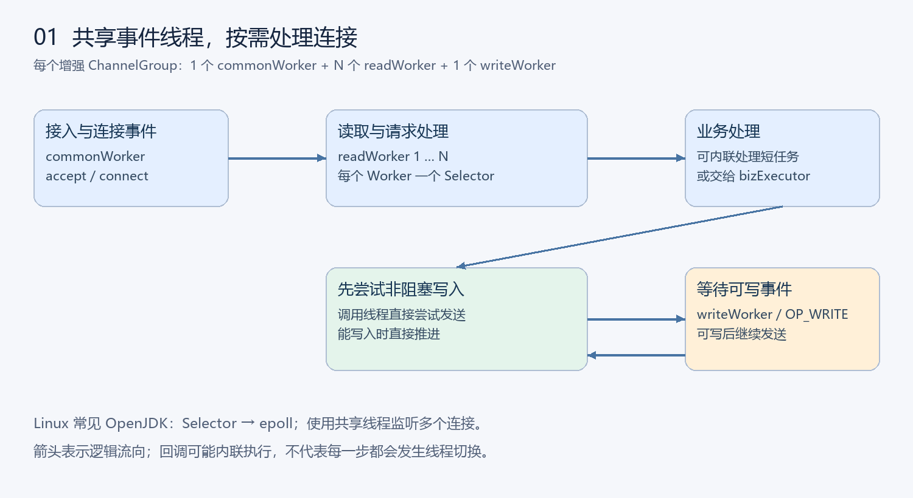
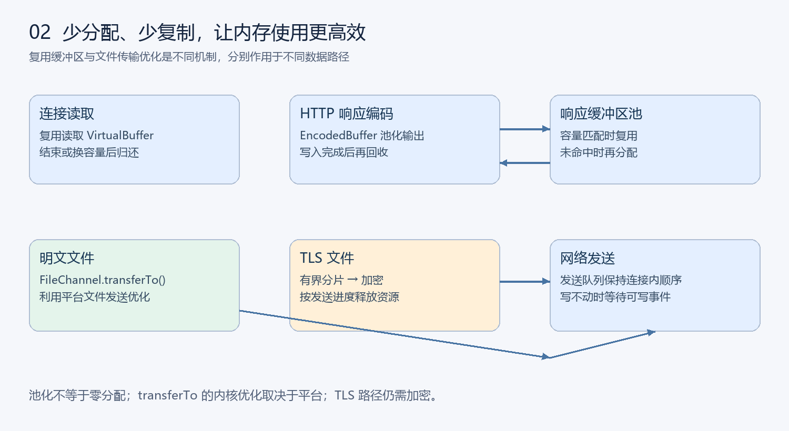
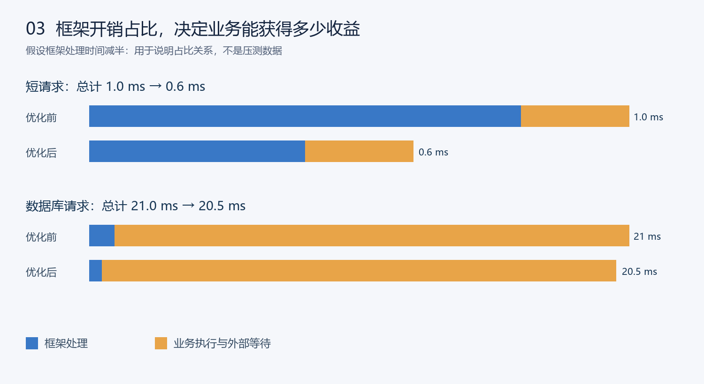

# tio-boot 为什么运行更快：从请求链路到内存复用

tio-boot 的性能优势，来自网络事件处理、业务调度、请求分发和数据发送等环节对开销的控制。共享 I/O 线程处理多个连接，直接 Handler 调用保持执行路径清晰，缓冲区复用减少重复分配，连接复用和高效文件传输进一步降低通信成本。这些设计在高频短请求、长连接及文件服务中具有不同的价值。

本文结合当前实现说明这些机制如何起作用。这里的“更快”指在合适的工作负载与配置下提高吞吐、降低处理开销，并不表示所有业务都获得相同倍数的提升。文中的三张示意图均为本文绘制；占比示例使用假设数字，不是新增压测结果。

[[toc]]

## 1. 先区分三种速度

**启动速度**关注应用多久能开始服务，主要受类加载、组件初始化及外部连接建立影响。轻量依赖和按需集成有助于缩短准备过程。

**吞吐量**关注单位时间完成多少请求，受 CPU、线程调度、网络带宽和外部服务容量共同影响。

**请求延迟**关注单次请求完成耗时。除平均值外，还要观察 P95、P99 等尾延迟，以了解并发压力下的响应稳定性。

启动快不能直接证明稳态吞吐高，连接数多也不等于每秒请求数高。GraalVM 原生编译可改善部分场景的启动与内存表现；JVM 经预热后的 JIT 优化同样重要，不能仅由打包方式判断稳态性能。

## 2. 共享事件线程，让连接等待不占用专属线程

在默认服务端增强通道路径中，aio-socket 提供异步回调接口，底层使用非阻塞 SocketChannel 和 Selector。常见 Linux OpenJDK 的 Selector 由 epoll 实现。连接数增加时，框架通过共享 Worker 监听多个连接，而不要求每个连接拥有一个长期阻塞的平台线程。



每个增强 ChannelGroup 包含一个 commonWorker、多个 readWorker 和一个 writeWorker。commonWorker 负责 accept、connect 等事件，另有特殊同步读取路径；新建连接轮询分配读 Worker，每个 Worker 使用独立的 Selector。

其性能价值在于：没有数据的连接由事件机制等待，线程主要处理已就绪的连接。在设备接入、WebSocket 和大量 keep-alive 连接场景下，可以用共享线程资源承担更多连接。

这里采用的是同一 JVM 内的线程模型，并非 master 管理多个 worker 进程。增强通道提供类似 AIO 的编程接口，不意味着底层直接使用 Linux 原生 AIO 或 io_uring。epoll 也是多种成熟网络框架共享的基础能力，tio-boot 的实际表现还取决于其上层调度与请求处理。

源码阅读入口：`EnhanceAsynchronousChannelGroup`、`EnhanceAsynchronousSocketChannel`、`TioServer`。特定配置可以切换到 JDK 自带异步通道，因此分析部署环境时应确认实际使用的路径。

## 3. 根据任务特征安排业务执行

网络就绪后，框架需要解码并处理业务。`DecodeTask` 提供两种执行方式：未配置 bizExecutor 时直接执行业务；配置后，通过连接上的有序调度将业务交给执行器。

对于纯内存计算、快速返回等短任务，内联处理可以省去一次任务提交、排队和线程交接。对于 JDBC、远程调用或耗时计算，业务执行器能够把耗时工作与 I/O 事件处理分开，避免同一 I/O Worker 因业务等待而延迟其他连接。

启用业务执行器后，同一连接按解码顺序安排业务，不同连接共享执行资源。这个机制兼顾连接内消息顺序与跨连接并发；应用自行启动的异步响应仍需协调输出顺序。

虚拟线程适合大量等待型任务，可以减少为等待维护大量平台线程的成本。它不会增加 CPU 核数，也不会自动提升数据库连接池容量。应结合业务阻塞比例选择执行器，而不是一律取消线程切换或一律增加线程数。

进一步阅读：[虚拟线程配置](../04_configuration/08.md)。

## 4. 直接 Handler 调用，保持请求处理路径清晰

典型 Handler 请求经过如下逻辑流程：

```text
网络读取 → HTTP 解码 → 拦截器与路由匹配 → Handler → 响应编码 → 发送
```

`TioBootHttpRequestDispatcher` 在路由匹配后直接调用 `HttpRequestHandler.handle(request)`。应用可以明确注册路由和处理器，通过普通 Java 方法完成核心业务，避免在 Handler 调用这一步引入反射式方法查找与调用。

这不意味着整个框架没有反射、没有拦截器或没有对象分配。Controller、AOP、序列化和其他扩展有各自的执行成本。选择 Handler 的价值是能够清楚控制热路径中执行的工作，并按业务需要启用组件。

路由匹配本身仍有成本。当前默认路由器的方法感知匹配会遍历已注册条目，并处理精确路径、通配符和模板规则，不能把所有路由都描述为固定时间的哈希查询。评估大量路由时，应使用接近实际路由规模与规则类型的测试。

下面提供一个返回固定 JSON 的处理器及注册配置。代码加入已有 tio-boot 应用即可使用，避免数据库与外部网络干扰，适合观察框架基础请求链路。

```java
package demo.handler;

import java.nio.charset.StandardCharsets;
import nexus.io.tio.boot.http.TioRequestContext;
import nexus.io.tio.http.common.HttpRequest;
import nexus.io.tio.http.common.HttpResponse;
import nexus.io.tio.http.server.handler.HttpRequestHandler;

public class PerformancePingHandler implements HttpRequestHandler {
  private static final byte[] BODY = "{\"ok\":true}".getBytes(StandardCharsets.UTF_8);

  @Override
  public HttpResponse handle(HttpRequest request) {
    HttpResponse response = TioRequestContext.getResponse();
    response.setBody(BODY);
    response.addHeader("Content-Type", "application/json; charset=utf-8");
    return response;
  }
}
```

```java
package demo.config;

import demo.handler.PerformancePingHandler;
import nexus.io.annotation.AConfiguration;
import nexus.io.annotation.Initialization;
import nexus.io.tio.boot.server.TioBootServer;
import nexus.io.tio.http.server.router.HttpRequestRouter;

@AConfiguration
public class PerformanceRouteConfiguration {
  @Initialization
  public void config() {
    HttpRequestRouter router = TioBootServer.me().getRequestRouter();
    router.get("/performance/ping", new PerformancePingHandler());
  }
}
```

固定字节数组只适用于固定、不可修改的正文，避免每次请求重复编码相同文本。实际业务的数据随请求变化时，应使用正常的响应模型和序列化流程；压测时也要把相应成本计算在内。

## 5. 复用缓冲区，减少重复分配与回收

高频请求不仅消耗 CPU 执行业务，也会反复申请读取、编码和发送缓冲区。缓冲区复用能够减少底层内存的重复申请，并有机会降低垃圾回收压力。



读取侧通过 VirtualBuffer 管理缓冲区，同一连接连续读取时复用，连接结束或容量变化时归还。发送侧由 `HttpResponseEncoder.encodeBuffer()` 使用池化输出，`EncodedBuffer` 将数据及其回收责任绑定，由发送任务在写入完成后释放。

等待部分写入时，数据仍由发送任务持有，不会提前回收。容量匹配的后续分配可以复用底层缓冲区，池未命中时仍会创建新缓冲区。

这种设计减少的是一部分重复分配，不是每次请求零分配。请求对象、业务对象、序列化结果及 TLS 密文仍可能分配内存。池化也需要保留一定容量，因此应观察分配速率、GC 时间和进程内存，而不是只看堆内存的单次快照。

详细说明见[HTTP、WebSocket 与 TCP 的缓冲区复用](../34_tio/33-buffer-reuse.md)。

## 6. 先直接写入，网络拥塞时再等待可写事件

当前增强通道的写操作先在调用线程尝试非阻塞写入。能够写入时直接推进；暂时无法写入时注册 OP_WRITE，由 writeWorker 在通道恢复可写后继续处理。

因此，单个 writeWorker 并不意味着全部发送都在一个线程上串行执行。不同连接的直接写入可以来自不同调用线程，writeWorker 主要承担等待写就绪后的推进工作。

这种策略让顺畅发送的路径保持简短，同时把等待客户端接收能力的阶段交给事件通知。普通响应、文件正文和 TLS 数据通过每连接发送队列维护发送进度与完成通知。

大量慢客户端或持续大流量发送，会增加写就绪处理压力；写完成回调也应保持简短。可写事件机制解决网络等待期间的线程占用，但应用仍需要规划发送量、超时和队列资源预算。

## 7. 复用连接，让连续请求减少重复握手

HTTP keep-alive 允许多个请求使用同一条 TCP 连接。与每次都建立新连接相比，可以减少 TCP 建连和连接资源初始化；HTTPS 连接复用还能减少重复 TLS 握手。

其效果在连续 API 调用、代理到后端通信和文件下载中较为明显。收益大小取决于网络往返时间、请求频率和连接策略。

HTTP/1.1 Pipelining 允许在同一连接上连续发送多个请求，能减少特定工作负载中的等待，但响应顺序及前序请求耗时仍会影响后续请求。它与 keep-alive 不同，比较压测结果时必须确认两端使用一致的连接和流水线参数。

相关报告：[HTTP/1.1 Pipelining 性能测试](09.md)。

## 8. 明文文件传输减少应用层数据搬运

增强通道上的明文文件正文使用 `FileChannel.transferTo()`。在操作系统与通道实现支持时，可以利用更高效的文件到 socket 传输路径，减少文件内容经过用户态缓冲区的复制。

这有利于静态资源及大文件下载：应用无需先把整个文件读取成 byte 数组，再作为普通响应正文发送。

TLS 文件需要加密，使用有界分片读取、加密与异步发送，具有不同的数据路径。`transferTo()` 的具体内核优化取决于平台，磁盘读取也可能占用当前线程，因此文件传输仍应结合磁盘速度、页缓存和网络带宽评估。

进一步阅读：[HTTP 长连接与高效文件传输](../34_tio/13-http-keep-alive-file-transfer.md)。

## 9. 为什么短请求更容易体现框架优势

请求总耗时可以粗略拆分为：

```text
连接与网络等待 + 框架处理 + 业务执行 + 外部服务等待 + 排队时间
```

框架处理占比越大，降低这部分成本对总耗时的影响越明显。



图中两组条形分别按各自优化前总时间归一化，不能用不同组的条形长度比较绝对耗时。

第一组假设框架处理 0.8 ms、业务处理 0.2 ms。框架处理减半后，总时间从 1.0 ms 降到 0.6 ms，减少 40%。第二组假设框架处理 1 ms、数据库等处理 20 ms，同样减半后，总时间从 21 ms 降到 20.5 ms，减少约 2.4%。

这些数字只说明占比关系。实际高并发服务还存在排队效应，降低每次请求的 CPU 消耗可能推迟饱和点，改善尾延迟；具体程度需要测量。对于外部等待占主导的应用，连接池、SQL、缓存和远程服务容量通常同样重要。

## 10. 用可复现测试判断收益

现有[性能对比报告](10.md)记录了回环网络、固定短响应和 keep-alive 等条件下的观察结果，适合了解基础网络链路。它不能单独证明某个机制贡献了多少提升，也不能直接代表数据库业务或公网 HTTPS 服务。

建议按下面的顺序建立自己的证据：

1. 固定硬件、JDK、堆大小、CPU 配额、响应内容、连接复用及 TLS 配置，记录测试对象与启动参数。
2. 充分预热 JVM，设置一致的并发和请求速率，重复测试并记录波动。
3. 同时记录成功请求吞吐量、错误率、P50/P95/P99 延迟、CPU、内存、GC 和线程状态。
4. 将固定响应、JSON 序列化、数据库访问与文件传输分别测试，观察各自瓶颈。
5. 使用 JFR 或性能剖析工具检查 CPU 热点、分配、锁等待与线程停顿；一次只改变一个因素，建立因果依据。
6. 检查压测客户端是否先饱和，避免将生成请求的能力误认为服务端极限。

tio-boot 提供了清晰的请求处理入口、可选择的业务调度方式，以及连接、缓冲区和发送流程的复用能力。让任务类型与这些机制匹配，再用真实业务负载验证，就能把框架的效率优势转化为可观察的吞吐和延迟收益。
