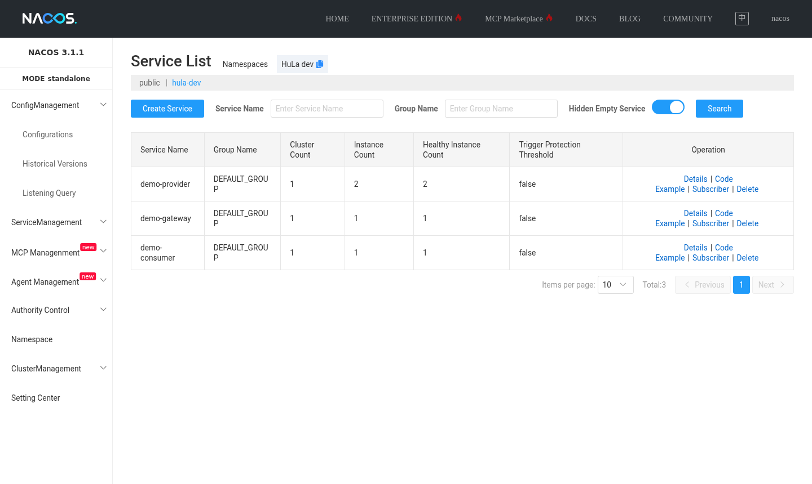
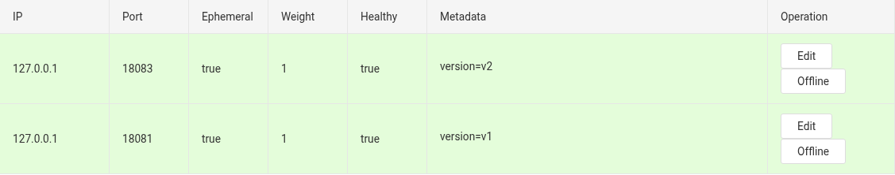
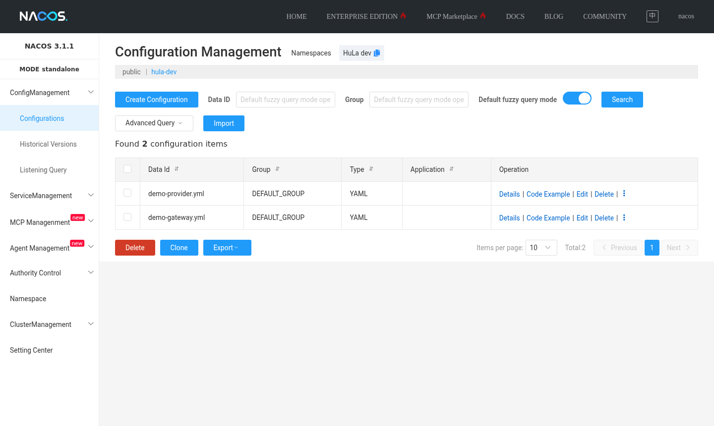

# Nacos 安装（Docker Compose）

Nacos 同时提供服务注册发现和配置中心，tio-boot 的微服务能力（注册、发现、配置、网关）都以它为注册中心。本文在一台机器上部署单机模式的 Nacos，配置数据存放在 MySQL 中，包含 2 个容器：

- `nacos-standalone`：Nacos 服务端。8080 是控制台，8848 是客户端 HTTP 接口，9848 是客户端 gRPC 端口（客户端与服务端之间的长连接、推送都走这个端口）。
- `nacos-mysql`：Nacos 的数据库，宿主机端口 13306，首次启动时自动导入 Nacos 的表结构。

## 目录结构

```
nacos/
├── docker-compose.yml
├── env/
│   ├── mysql.env
│   └── nacos-standalone.env
├── init/
│   └── nacos-schema.sql
├── mysql/data/
└── nacos/logs/
```

`init/nacos-schema.sql` 是 Nacos 发行包 `conf/mysql-schema.sql` 中的建表语句，放进 MySQL 容器的 `/docker-entrypoint-initdb.d` 后，数据库第一次初始化时会自动执行。

```shell
mkdir -p nacos/env nacos/init nacos/mysql/data nacos/nacos/logs
cd nacos
```

## env/mysql.env

```properties
MYSQL_ROOT_PASSWORD=123456
MYSQL_DATABASE=nacos
MYSQL_USER=nacos
MYSQL_PASSWORD=n2SWa3j45a6AdmZE
LANG=C.UTF-8
MYSQL_ROOT_HOST=%
```

`MYSQL_DATABASE` 和 `MYSQL_USER` 会在初始化时创建 `nacos` 库和同名账号。

## env/nacos-standalone.env

```properties
PREFER_HOST_MODE=hostname
MODE=standalone
SPRING_DATASOURCE_PLATFORM=mysql
MYSQL_SERVICE_HOST=nacos-mysql
MYSQL_SERVICE_DB_NAME=nacos
MYSQL_SERVICE_PORT=3306
MYSQL_SERVICE_USER=nacos
MYSQL_SERVICE_PASSWORD=n2SWa3j45a6AdmZE
MYSQL_SERVICE_DB_PARAM=characterEncoding=utf8&connectTimeout=1000&socketTimeout=3000&autoReconnect=true&useUnicode=true&useSSL=false&serverTimezone=Asia/Shanghai&allowPublicKeyRetrieval=true
NACOS_AUTH_ENABLE=true
NACOS_AUTH_IDENTITY_KEY=nacos-identity
NACOS_AUTH_IDENTITY_VALUE=nacos-identity-value
NACOS_AUTH_TOKEN=VGhpc0lzTXlDdXN0b21TZWNyZXRLZXkwMTIzNDU2Nzg=
```

- `MYSQL_SERVICE_HOST` 写 MySQL 的容器名，端口写容器内端口 3306，两个容器在同一个 Compose 网络中直接互通。
- `NACOS_AUTH_ENABLE=true` 开启鉴权，客户端需要用户名和密码才能注册和读取配置。
- `NACOS_AUTH_TOKEN` 是签发访问令牌的密钥，必须是 Base64 编码、解码后不少于 32 字节；生产环境请换成自己的随机值。

## docker-compose.yml

```yaml
name: nacos
services:
  nacos:
    image: nacos/nacos-server:${NACOS_VERSION:-v3.1.1}
    container_name: nacos-standalone
    env_file:
      - ./env/nacos-standalone.env
    volumes:
      - ./nacos/logs:/home/nacos/logs
    ports:
      - "8080:8080"
      - "8848:8848"
      - "9848:9848"
    depends_on:
      nacos-mysql:
        condition: service_healthy
    restart: always
  nacos-mysql:
    container_name: nacos-mysql
    image: mysql:8.0.30
    command:
      - --sql-mode=STRICT_TRANS_TABLES,NO_ZERO_IN_DATE,NO_ZERO_DATE,ERROR_FOR_DIVISION_BY_ZERO,NO_ENGINE_SUBSTITUTION
      - --character-set-server=utf8mb4
      - --collation-server=utf8mb4_unicode_ci
    env_file:
      - ./env/mysql.env
    volumes:
      - ./mysql/data:/var/lib/mysql
      - ./init:/docker-entrypoint-initdb.d
    ports:
      - "13306:3306"
    healthcheck:
      test: ["CMD", "mysqladmin", "ping", "-h", "localhost"]
      interval: 5s
      timeout: 10s
      retries: 20
    restart: always
```

`depends_on` 加上 `condition: service_healthy`，Nacos 会等 MySQL 可以连接之后再启动。

## 启动与验证

```shell
docker compose up -d
docker compose ps
```

查看服务端状态，`auth_enabled` 为 `true`、`startup_mode` 为 `standalone`：

```shell
curl -s http://127.0.0.1:8848/nacos/v3/admin/core/state
```

### 初始化管理员

开启鉴权后，第一次使用需要设置管理员 `nacos` 的密码（只能设置一次，也可以在控制台首次登录时设置）：

```shell
curl -X POST 'http://127.0.0.1:8848/nacos/v3/auth/user/admin' -d 'password=nacos'
```

登录取得访问令牌：

```shell
TOKEN=$(curl -s -X POST 'http://127.0.0.1:8848/nacos/v3/auth/user/login' \
  -d 'username=nacos&password=nacos' | python3 -c 'import sys,json;print(json.load(sys.stdin)["accessToken"])')
```

### 创建命名空间

不同环境或不同项目用命名空间隔离，下面创建 ID 为 `hula-dev` 的命名空间，后续各章的示例都注册到这里：

```shell
curl -X POST "http://127.0.0.1:8848/nacos/v3/admin/core/namespace" -H "accessToken: $TOKEN" \
  -d 'namespaceId=hula-dev&namespaceName=hula-dev&namespaceDesc=dev'
curl -s "http://127.0.0.1:8848/nacos/v3/admin/core/namespace/list" -H "accessToken: $TOKEN"
```

### 发布一条配置

```shell
curl -X POST "http://127.0.0.1:8848/nacos/v3/admin/cs/config" -H "accessToken: $TOKEN" \
  --data-urlencode "dataId=demo-provider.yml" --data-urlencode "groupName=DEFAULT_GROUP" \
  --data-urlencode "namespaceId=hula-dev" --data-urlencode "type=yaml" \
  --data-urlencode $'content=demo:\n  greeting: Hi from Nacos\n'
```

### 控制台

浏览器打开 `http://127.0.0.1:8080`，用 `nacos/nacos` 登录。在“服务管理 → 服务列表”中切换到 `hula-dev`，可以看到后续章节中注册的服务及实例数：



服务详情中列出每个实例的地址、权重、健康状态和元数据，元数据可以用来做灰度发布：



“配置管理 → 配置列表”中是各服务的配置，修改后客户端立即收到推送：



## 常见问题

- 客户端连接 8848 后还会连接 9848 的 gRPC 端口，防火墙和端口映射两个端口都要放开。
- 控制台登录提示需要初始化密码时，先执行上面的“初始化管理员”。
- 修改了 `mysql.env` 中的账号密码后需要删除 `mysql/data` 重新初始化，MySQL 只在数据目录为空时执行初始化脚本。
